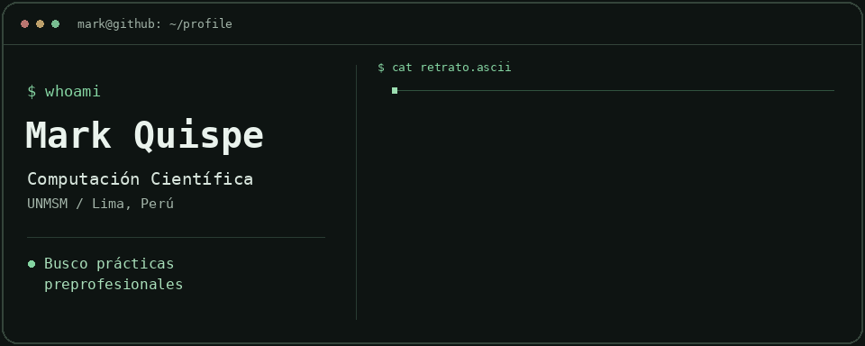

  

### Proyectos destacados

| Proyecto | Qué hace |
| --- | --- |
| [Academic Search RAG](https://github.com/mark-quispe/Academic-Search-RAG) | API grupal en FastAPI para consultar mallas curriculares de la UNMSM con citas al documento oficial y a la página. |
| [LexiSoar](https://github.com/mark-quispe/Lexisoar) | Aplicación web para practicar inglés con historias, ejercicios y seguimiento del progreso. |
| [Claude Demo Recorder](https://github.com/mark-quispe/claude-demo-recorder) | Plugin para Windows que graba demos de Claude Code con subtítulos, pasos y un indicador de clics. |

### Herramientas y aprendizaje

`Python` · `Git` · `LaTeX` · `PostgreSQL` · `Neon` · `Vercel` · `Google Cloud`

Estoy reforzando **Python y SQL** para trabajar con datos. En mi tesis, estudio cómo los retrasos en las intervenciones cambian la evolución del contagio financiero y las estrategias de control.

[LinkedIn](https://www.linkedin.com/in/mark-quispe-gonzales-839200382/) · [Contribuciones en GitHub](https://github.com/mark-quispe#contributions)
