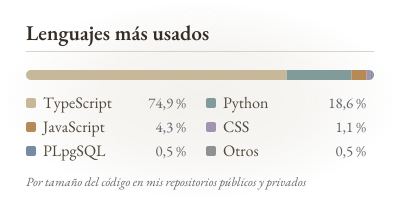

  

<a href="https://github.com/mark-quispe#contributions">
  <picture>
    <source media="(prefers-color-scheme: dark)" srcset="./cards/stats-dark.svg">
    
  </picture>
</a>
<a href="https://github.com/mark-quispe?tab=repositories">
  <picture>
    <source media="(prefers-color-scheme: dark)" srcset="./cards/languages-dark.svg">
    
  </picture>
</a>
 

## Proyectos destacados

<table>
<tr>
<th width="50%">Aplicaciones</th>
<th width="50%">Herramientas para Claude Code</th>
</tr>
<tr valign="top">
<td>

**[Academic Search RAG](https://github.com/mark-quispe/Academic-Search-RAG)** 
API grupal para consultar las mallas curriculares de la UNMSM, citando documento y página. 
Python · FastAPI · RAG

</td>
<td>

**[Claude Plan Limits](https://github.com/Gonriel-Labs/claude-plan-limits)** 
Cuánto del plan has usado, cuándo se reinicia y el costo equivalente de la sesión. 
Plugin de Claude Code

</td>
</tr>
<tr valign="top">
<td>

**[Gestión de Pedidos](https://github.com/mark-quispe/GESTION-PEDIDOS)** `en desarrollo` 
Registro y consulta de pedidos para un estudio de arquitectura. 
Web · PostgreSQL

</td>
<td>

**[Claude Chat Notes](https://github.com/Gonriel-Labs/claude-chat-notes)** 
Guarda fragmentos de las respuestas de Claude como notas, por proyecto y tema. 
Plugin de Claude Code

</td>
</tr>
</table>

## Herramientas y aprendizaje

`Python` · `Git` · `LaTeX` · `PostgreSQL` · `Neon` · `Vercel` · `Google Cloud`

Estoy reforzando **Python y SQL** para trabajar con datos. En mi tesis, estudio cómo los retrasos en las intervenciones cambian la evolución del contagio financiero y las estrategias de control.

[LinkedIn](https://www.linkedin.com/in/mark-quispe-gonzales-839200382/) · [Contribuciones en GitHub](https://github.com/mark-quispe#contributions)
