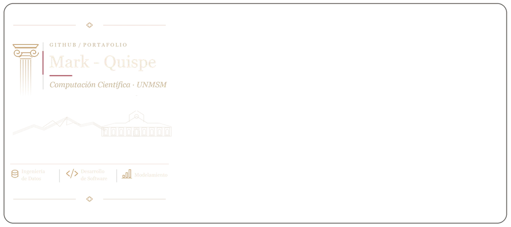
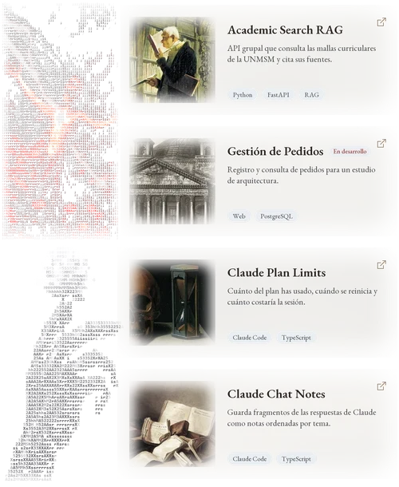
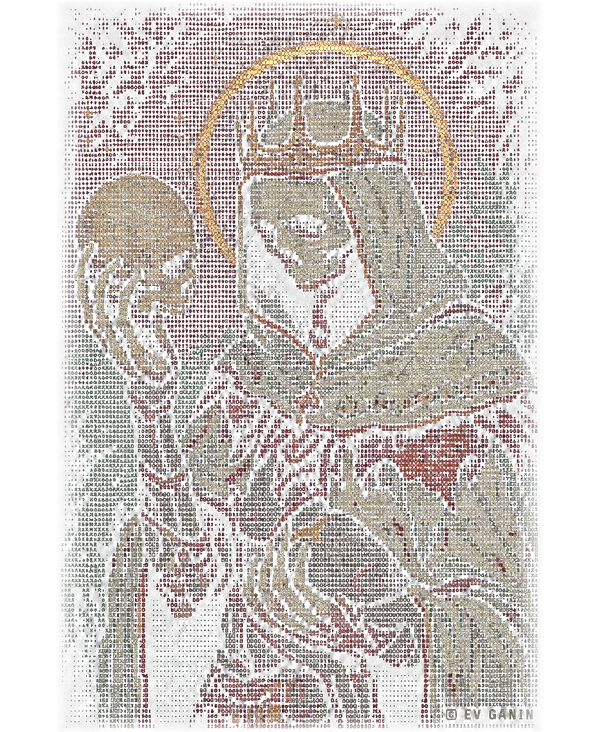
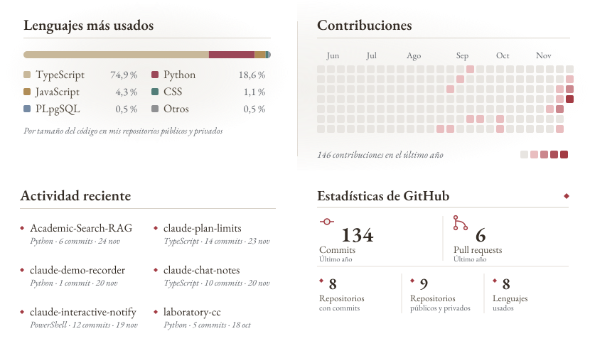

   
<picture>
  <source media="(prefers-color-scheme: dark)" srcset="./cards/separador-proyectos-compacto-dark.svg">
  
</picture> 
<a href="https://github.com/mark-quispe/Academic-Search-RAG">Academic Search RAG</a> · <a href="https://github.com/mark-quispe/GESTION-PEDIDOS">Gestión de Pedidos</a> · <a href="https://github.com/Gonriel-Labs/claude-plan-limits">Claude Plan Limits</a> · <a href="https://github.com/Gonriel-Labs/claude-chat-notes">Claude Chat Notes</a> 
<picture><source media="(prefers-color-scheme: dark)" srcset="./art/proyectos_ascii_tormenta_dark.webp"></picture>

<picture>
  <source media="(prefers-color-scheme: dark)" srcset="./cards/panel-datos-seis-dark.svg">
  
</picture>

<picture>
  <source media="(prefers-color-scheme: dark)" srcset="./cards/sobre-mi-dark.svg">
  
</picture>

  <a href="https://www.linkedin.com/in/mark-quispe-gonzales-839200382/">LinkedIn</a> · <a href="https://github.com/mark-quispe?tab=repositories">Repositorios</a>
   
  Pinturas de dominio público: Wright of Derby, Philippe de Champaigne, Carl Spitzweg, Jan Davidsz. de Heem y Piranesi (<a href="./CREDITOS.md">créditos</a>).

