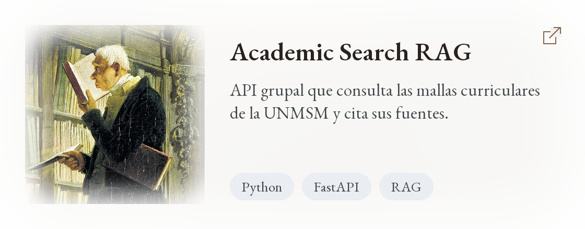
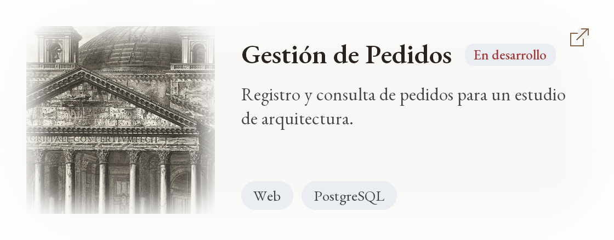
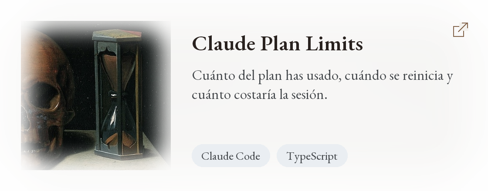
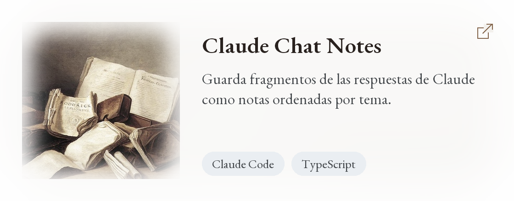
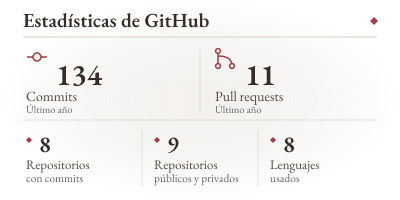
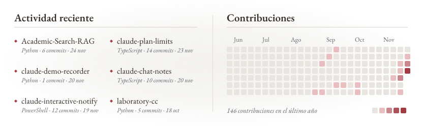
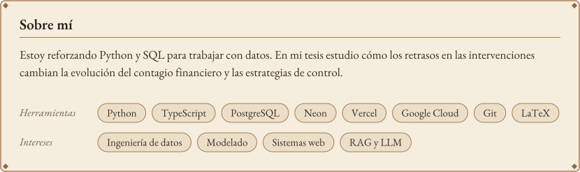

  

<picture>
  <source media="(prefers-color-scheme: dark)" srcset="./cards/separador-proyectos-dark.svg">
  
</picture>

  
  <a href="https://github.com/mark-quispe/Academic-Search-RAG"><picture><source media="(prefers-color-scheme: dark)" srcset="./art/academic-search-rag-dark.png"></picture></a> 
  <a href="https://github.com/mark-quispe/GESTION-PEDIDOS"><picture><source media="(prefers-color-scheme: dark)" srcset="./art/gestion-pedidos-dark.png"></picture></a> 
  <a href="https://github.com/Gonriel-Labs/claude-plan-limits"><picture><source media="(prefers-color-scheme: dark)" srcset="./art/claude-plan-limits-dark.png"></picture></a> 
  <a href="https://github.com/Gonriel-Labs/claude-chat-notes"><picture><source media="(prefers-color-scheme: dark)" srcset="./art/claude-chat-notes-dark.png"></picture></a>

 

<a href="https://github.com/mark-quispe#contributions"><picture><source media="(prefers-color-scheme: dark)" srcset="./cards/stats-dark.svg"></picture></a>
<a href="https://github.com/mark-quispe?tab=repositories"><picture><source media="(prefers-color-scheme: dark)" srcset="./cards/languages-dark.svg"></picture></a>

<picture>
  <source media="(prefers-color-scheme: dark)" srcset="./cards/actividad-dark.svg">
  
</picture>

<picture>
  <source media="(prefers-color-scheme: dark)" srcset="./cards/sobre-mi-dark.svg">
  
</picture>

  <a href="https://www.linkedin.com/in/mark-quispe-gonzales-839200382/">LinkedIn</a> · <a href="https://github.com/mark-quispe?tab=repositories">Repositorios</a>
   
  Pinturas de dominio público: Wright of Derby, Philippe de Champaigne, Carl Spitzweg, Jan Davidsz. de Heem y Piranesi (<a href="./CREDITOS.md">créditos</a>).

